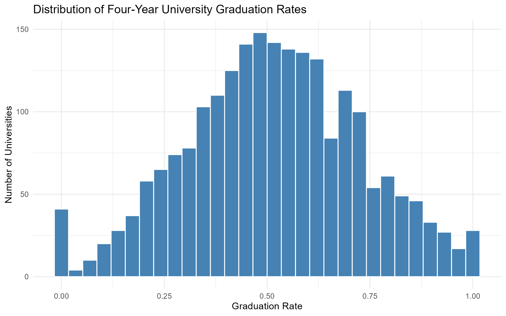
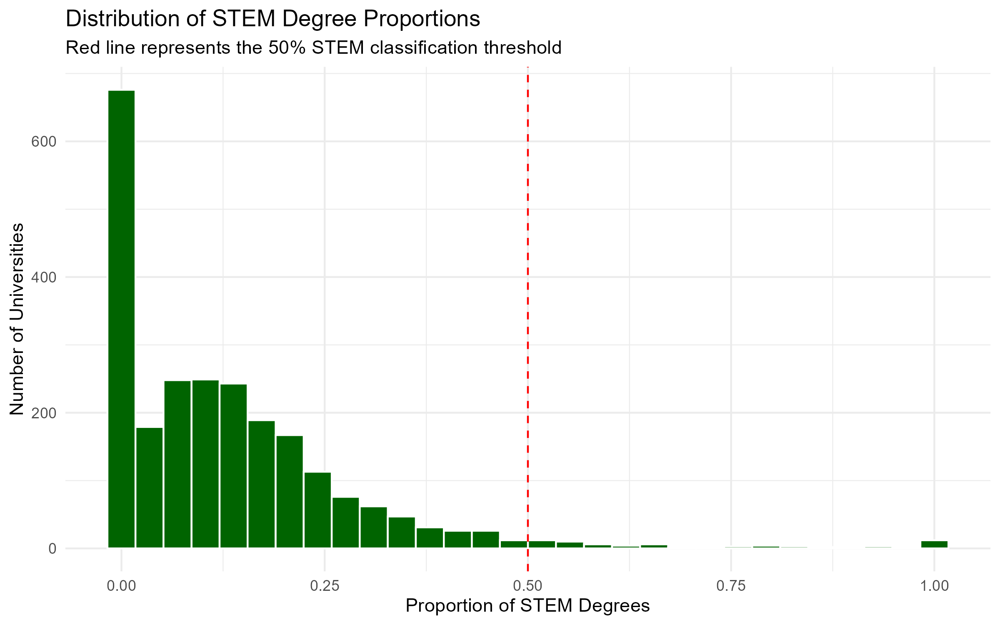
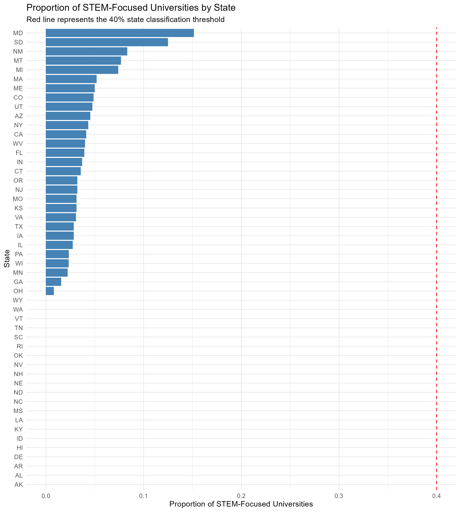
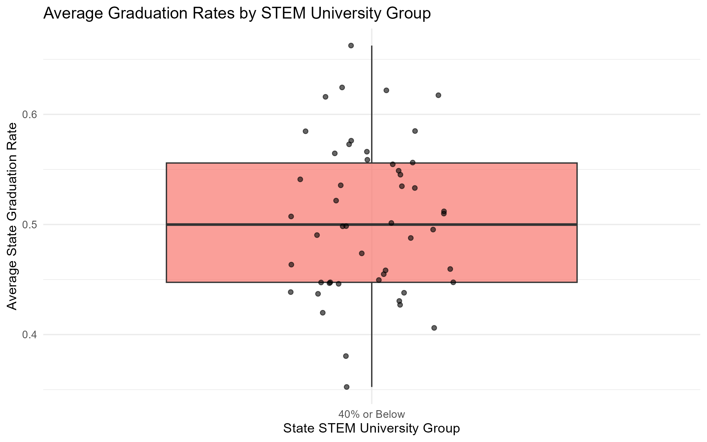
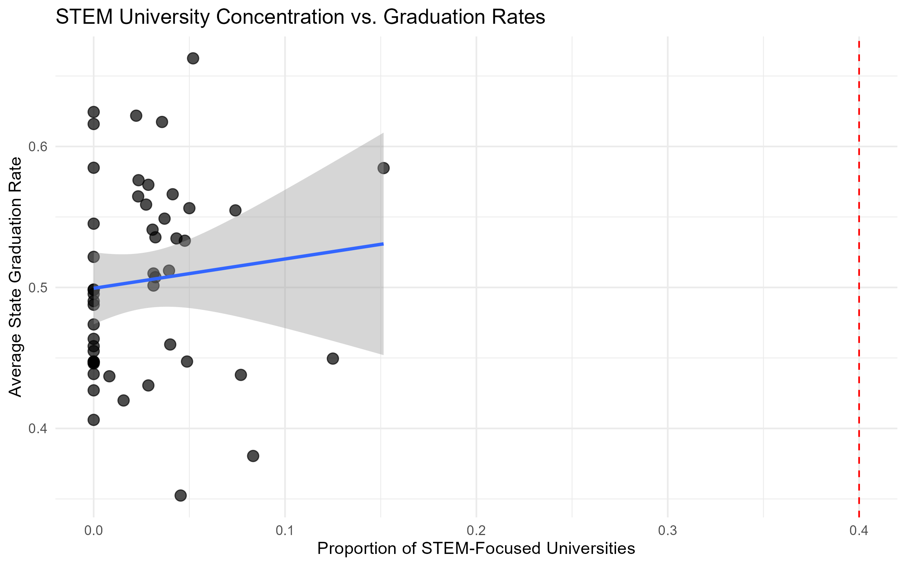

This project examines whether states with more than 40% of their four-year institutions classified as predominantly STEM-focused have higher average graduation rates than states with 40% or fewer such institutions. The analysis uses institutional data from the U.S. Department of Education College Scorecard. Four-year institutions are identified using the dataset's `ICLEVEL` field, and graduation outcomes are measured using `C150_4`. The preliminary operational definition sums seven selected STEM-related program shares and classifies an institution as STEM-focused when the sum is at least 50%. Initial inspection of the uploaded data identifies 2,903 four-year institutions across the 50 states, with 2,415 having complete values for the seven selected program fields. Seventy-two institutions meet the current STEM threshold, and no state exceeds the 40% state-level threshold. Unfortunately, this was not discovered until after I had finished writing the code for file 21, at which point I would not have time to redo everything before the halfway report is due. I will go back and revise the research question for the final project.


The project is motivated by the importance of STEM education to the workforce, innovation, and economic development. Comparing state-level institutional composition and graduation outcomes may provide an initial description of whether these measures move together. The analysis may be of interest to education researchers, policymakers, and institutions considering how academic program offerings relate to student completion. I would have been testing the hypothesis that states with a proportion of universities focusing in STEM above 40% would have a higher average graduation rate, but the research question needs to be reworked.

- The project uses the U.S. Department of Education College Scorecard institutional dataset, which contains 6,278 institutions and 3,379 variables in the supplied CSV.
- Filtering to `ICLEVEL == 1` produces 2,903 four-year institutions across the 50 states.
- Of these institutions, 2,415 have complete values for the seven selected PCIP fields. Under the preliminary definition that at least 50% of awarded degrees must be in those fields, 72 institutions are classified as STEM-focused.
- No state exceeds the proposed 40% STEM-institution threshold. Thus, the current data definition produces no states in the above-40% group, so the planned Welch two-sample t-test cannot be performed.
- The next priority is to review and justify the STEM field definition and institution-level threshold, then rerun the state aggregation, visualizations, and statistical analysis.

The project uses the supplied `Most-Recent-Cohorts-Institution - Copy.csv` file, identified as a U.S. Department of Education College Scorecard institutional dataset. The supplied file contains 6,278 rows and 3,379 columns. Each row represents an institution. Because the supplied CSV's release date has not been independently verified from the file itself, all numerical findings below are explicitly tied to this project copy rather than claimed to be the newest College Scorecard release.

The analysis uses the following variables:

| Variable | Description | Role |
|---|---|---|
| `UNITID` | Institution identifier | Unique institution key |
| `OPEID`, `OPEID6` | Additional institution identifiers | Identification |
| `INSTNM` | Institution name | Identification |
| `STABBR` | State abbreviation | State aggregation |
| `ICLEVEL` | Institution level | Four-year institution filter |
| `PREDDEG` | Predominant degree awarded | Institution description |
| `C150_4` | Four-year graduation rate | Outcome |
| `PCIP11` | Computer and information sciences | STEM degree-share component |
| `PCIP14` | Engineering | STEM degree-share component |
| `PCIP15` | Engineering technologies | STEM degree-share component |
| `PCIP26` | Biological and biomedical sciences | STEM degree-share component |
| `PCIP27` | Mathematics and statistics | STEM degree-share component |
| `PCIP40` | Physical sciences | STEM degree-share component |
| `PCIP41` | Science technologies | STEM degree-share component |

The current workflow selects four-year institutions using `ICLEVEL == 1`. This produces 2,903 institutions across the 50 states in the supplied file. Of these, 2,202 have a nonmissing `C150_4` graduation-rate value.

The STEM share is calculated from seven selected PCIP variables. Institutions are classified only when all seven values are present; missing PCIP values are not treated as zero. There are 2,415 institutions with complete values for all seven selected fields.

The cleaning workflow also checks missing values and duplicate `UNITID` values. The source data should remain unchanged; cleaned and processed datasets are saved as separate files.

For institution \(i\), the preliminary STEM share is:

\[
STEMShare_i =
PCIP11_i + PCIP14_i + PCIP15_i + PCIP26_i +
PCIP27_i + PCIP40_i + PCIP41_i
\]

An institution is classified as predominantly STEM-focused when its calculated STEM share is at least 0.50. This is a project-specific operational definition. The seven selected fields may not cover every discipline that could reasonably be considered STEM.

For state \(s\), the state STEM-institution proportion is:

\[
STEMProportion_s =
\frac{\text{Number of classified STEM-focused four-year institutions in state }s}
{\text{Number of four-year institutions in state }s\text{ with complete selected PCIP data}}
\]

The state group is defined as `Above 40%` if this proportion is strictly greater than 0.40, and `40% or Below` otherwise.

In the supplied data, 72 of 2,415 institutions with complete selected PCIP data meet the 50% institution-level definition. However, the state with the largest resulting proportion has 5 qualifying institutions out of 33 (15.15%). Thus, no state meets the separate, greater-than-40% state-level cutoff.

The initial processing of the supplied CSV produced the following counts:

| Measure | Preliminary result |
|---|---:|
| Institutions in original dataset | 6,278 |
| Variables in original dataset | 3,379 |
| Four-year institutions in the 50 states (`ICLEVEL == 1`) | 2,903 |
| Four-year institutions with a reported `C150_4` value | 2,202 |
| Four-year institutions with complete values for all seven selected PCIP fields | 2,415 |
| Institutions meeting the 50% selected-STEM-share threshold | 17 |
| States in the analysis | 50 |
| States with more than 40% STEM-focused institutions | 0 |

Under the current operational definition, the largest state-level STEM proportion is 15.15% (Maryland: 5 of 33 institutions with complete selected PCIP data). South Dakota is next at 12.50% (2 of 16). The unweighted mean of the 50 state-level average graduation rates is approximately 50.49%; the median state average is approximately 49.99%.
```{r}
source("~/GitHub/Stat107_Final_Project/00_requirements.R")

```
The planned histogram of `C150_4` will show the distribution of institution-level graduation rates among four-year institutions. It will help identify concentration, skewness, and unusually high or low values.
```{r}

```
The STEM-share histogram will show how the selected seven fields contribute to institutions' awarded degrees. A vertical reference line at 0.50 will show the institution classification threshold.
```{r}

```
A state bar chart will display the proportion of four-year institutions classified as STEM-focused in each state. A horizontal line at 0.40 will identify the proposed state threshold.
```{r}

```
A box plot is planned to compare state average graduation rates between the two groups. However, it should not be interpreted or presented as a two-group comparison until both groups contain states.
```{r}

```
A scatter plot will examine the continuous relationship between state STEM proportions and state average graduation rates. Unlike the two-group comparison, this plot can be generated because the STEM proportion varies across states even though none exceeds 40%.

As mentioned, the research question needs to be reworked, but if there had been states above the 40% benchmark, the hypothesis being tested would have been that states with a high concentration of STEM focused universities have a higher average rate of graduation. This would have been done with a direct comparison between STEM proportion and graduation rates. Theoretically, this can be done with: 


\[
AverageGraduationRate_s =
\beta_0 + \beta_1 STEMProportion_s + \epsilon_s
\]

The coefficient \(\beta_1\) will describe the estimated change in average state graduation rate associated with a one-unit increase in the STEM proportion. The model will be evaluated using the coeficient estimate, confidence interval, p-value, \(R^2\), and residual diagnostics.

Currently, there is a lot of work to do, with the research question needing to be reworked. However, as previously discussed, I am working on this project alone, since my groupmates have consistently been absent from discussion sections, and have only reached out today to communicate about the project. I have discussed with Nathalie, and I will be proceeding on my own.